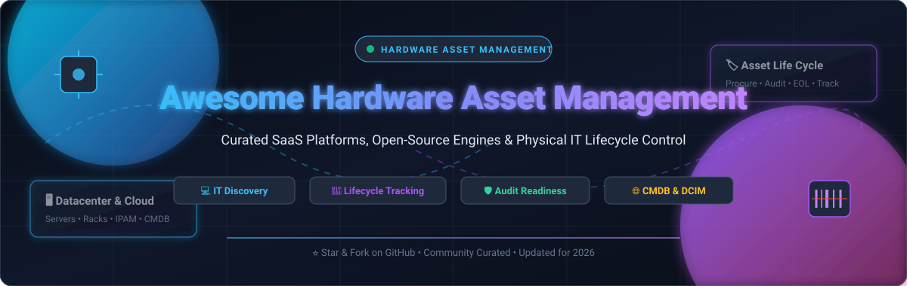

<p align="center">
  
</p>

<p align="center">
  <a href="https://github.com/ishandutta2007/Awesome-Awesome-Awesome"></a><a href="https://discord.gg/jc4xtF58Ve"></a>
  <a href="https://github.com/ishandutta2007/Awesome-Hardware-Asset-Management-Ham/stargazers"></a>
  <a href="https://github.com/ishandutta2007/Awesome-Hardware-Asset-Management-Ham/network/members"></a>
  <a href="https://github.com/ishandutta2007/Awesome-Hardware-Asset-Management-Ham/issues"></a>
  <a href="https://github.com/ishandutta2007/Awesome-Hardware-Asset-Management-Ham/blob/main/LICENSE"></a>
  <a href="https://github.com/ishandutta2007"></a>
</p>

---

# 🖥️ Awesome Hardware Asset Management (HAM) 🏷️

> A curated, SEO-optimized directory of enterprise **SaaS platforms**, **open-source HAM tools**, and **automated IT discovery engines**. Master hardware lifecycle management—from procurement, deployment, and active tracking to audit readiness, compliance, and secure retirement.

---

## 📑 Table of Contents

- [🌟 Introduction & Key Concepts](#-introduction--key-concepts)
- [📊 Sector Overview & Market Dynamics](#-sector-overview--market-dynamics)
- [🏢 SaaS & Hosted Commercial Platforms](#-saas--hosted-commercial-platforms)
- [🔓 Open-Source GitHub Projects](#-open-source-github-projects)
- [🛠️ Core Capabilities Matrix](#️-core-capabilities-matrix)
- [🤝 How to Contribute](#-how-to-contribute)
- [💖 Support & Sponsorship](#-support--sponsorship)
- [📈 Star History](#-star-history)
- [⚖️ Disclaimer & License](#️-disclaimer--license)

---

## 🌟 Introduction & Key Concepts

**Hardware Asset Management (HAM)** is a foundational pillar of **IT Asset Management (ITAM)**. It encompasses the structured management of physical technology components—such as end-user laptops, physical servers, networking switches, storage racks, IoT devices, and specialized peripherals—throughout their entire lifespan.

```
  [ 🛒 Procurement ] ──▶ [ 📦 Receiving & Tagging ] ──▶ [ ⚙️ Provisioning ]
                                                              │
  [ ♻️ EOL Disposal ] ◀── [ ⚠️ Decommissioning ] ◀─── [ 🔍 Active Audit / CMDB ]
```

### 🎯 Primary Objectives of Modern HAM:
- 🔍 **Automated Asset Discovery**: Eliminate shadow IT and untracked network endpoints using agent-based and agentless scanning.
- 🏷️ **Custody & Ownership Tracking**: Maintain audit-proof trails of device assignments, department cost centers, and physical locations.
- 📉 **Lifecycle & Depreciation Control**: Monitor total cost of ownership (TCO), warranty expiration, lease returns, and capital depreciation schedules.
- 🛡️ **Regulatory Compliance & Audit Readiness**: Adhere to ISO/IEC 19770 standards, SOC 2, NIST, and GDPR security requirements.
- 🔌 **Configuration Management Database (CMDB) Sync**: Feed real-time physical device topology into ITSM workflows to resolve incidents faster.

---

## 📊 Sector Overview & Market Dynamics

The global **Hardware Asset Management (HAM)** and ITAM software market is valued at approximately **$2.5B to $3.5B in pure-play software ARR**, expanding to over **$30B+ annually** when factoring in comprehensive hardware lifecycle logistics, maintenance contracts, and IT asset disposition (ITAD) services. The sector is compounding at a healthy **10.5% – 11.8% CAGR** toward 2030, accelerated by remote/hybrid work distributions, multi-cloud data center footprints, and stricter cybersecurity asset compliance mandates.

The market structure is **moderately fragmented**:
- 🏛️ **Enterprise Tier (Consolidated / Oligopolistic)**: The high-end enterprise ITSM segment is concentrated around mega-cap suites like **ServiceNow**, **Flexera**, and **Ivanti**, which command large multi-year enterprise contracts and serve as global single sources of truth.
- 🚀 **Mid-Market & Specialized Edge (Fragmented)**: The mid-market, SMB, and edge network discovery spaces remain intensely competitive and fragmented across agile SaaS specialists (such as **Lansweeper**, **Device42**, and **Asset Panda**) alongside an active ecosystem of self-hosted open-source software (such as **Snipe-IT** and **NetBox**) that provide sovereign asset control without per-device tax.

---

## 🏢 SaaS & Hosted Commercial Platforms

The following commercial solutions represent the category leaders in enterprise Hardware Asset Management, sorted in descending order by **Company Size (Revenue / Valuation)**.

| 🏢 Product | 📈 Company Size (Revenue / Valuation) | 💵 Starting Tier Price | 🎁 Free Tier / Trial Limit | ⚡ Key HAM Capabilities |
| :--- | :--- | :--- | :--- | :--- |
| **[ServiceNow HAM](https://www.servicenow.com/)** | **$10.98B Revenue** / ~$170B Market Cap *(NYSE: NOW)* | **~$30,000 / year** *(Enterprise modular starting contract)* | **15-day guided sales POC**; free permanent Developer Sandboxes via developer program | Comprehensive enterprise HAM; AI-driven PO generation from invoice attachments; dynamic asset health scores; continuous automated physical audits; Data Center Network & Asset Management (DCNAM). |
| **[Flexera](https://www.flexera.com/)** *(incl. Snow Software)* | **$2.90B Valuation** / ~$400M ARR *(Thoma Bravo)* | **~$25,000 / year** *(Flexera One entry package)* | **30-day custom POC trial** *(Scope-tailored evaluation with sales engineering support)* | Technopedia catalog covering >5M hardware products with authoritative specifications; automated hardware obsolescence and EOL/EOS tracking; hybrid ITAM + FinOps normalization. |
| **[Ivanti Neurons for HAM](https://www.ivanti.com/)** *(incl. Cherwell)* | **$2.00B+ Valuation** / ~$500M Revenue *(Clearlake & TA Associates)* | **~$25 / device / year** *(Entry discovery tiers; platform minimum ~$5,000/yr)* | **30-day structured pilot trial** *(Full network discovery feature access during evaluation)* | Hybrid active and passive agentless network scanning; real-time 360° device insights; FedRAMP Moderate and DoD IL5 certified; automated procurement to disposal workflows. |
| **[ManageEngine AssetExplorer](https://www.manageengine.com/products/asset-explorer/)** | **$1.10B+ Revenue** / ~$10B+ Private Valuation *(Zoho Corp)* | **$955 / year** *(Up to 250 assets package)* | **Free forever up to 25 nodes (on-prem) / 50 nodes (cloud)**; 30-day trial for up to 250 nodes | Out-of-the-box multi-platform network scanning (Windows, Linux, macOS, SNMP); software compliance auditing; CMDB relationship visualization; purchase orders and contract management. |
| **[Lansweeper](https://www.lansweeper.com/)** | **$850M (€800M) Valuation** / $115M ARR *(Bridgepoint)* | **$239 / month** *billed annually (~$2,868/yr for up to 2,000 assets)* | **Free forever up to 100 assets**; 14-day full-feature free trial *(Unlimited discovery scans during trial)* | Deep IT/OT/IoT asset discovery without requiring credentials; shadow IT surfacing; automated hardware warranty lookup directly from OEMs; ISO 19770 and NIST audit reporting. |
| **[Device42](https://www.device42.com/)** | **$230M Acquisition Valuation** *(Parent: Freshworks, NASDAQ: FRSH)* | **$1,449 / year** *(Core tier: up to 100 devices and 1,000 IP addresses)* | **14-day free trial** *(Up to 100 devices with full automated discovery and CMDB enabled)* | Continuous agentless CMDB discovery; automated dependency mapping (ADM); full Data Center Infrastructure Management (DCIM) with rack elevation drawings and thermal/power monitoring. |
| **[Asset Panda](https://www.assetpanda.com/)** | **~$20M ARR** / ~$60M Valuation *(Private)* | **$3,000 / year** *(Starter tier: up to 1,000 assets & 5 user seats)* | **7-day full-feature free trial** *(Includes mobile app barcode scanner and custom fields)* | Mobile-first barcode/QR code auditing; digital custody handoffs with electronic signatures; maintenance work orders and repair tracking; flexible custom fields and audit templates. |
| **[Hardcat](https://hardcat.com/)** | **~$12M Revenue** / ~$30M Valuation *(Private)* | **$5,000 / year** *(Base enterprise annual subscription)* | **14-day vendor-assisted pilot sandbox** *(Custom sample asset database configuration)* | Enterprise fixed asset management; Compliance Policy Framework for risk-based continuous validation; RFID and barcode physical tracking; sub-meter GPS asset positioning. |

---

## 🔓 Open-Source GitHub Projects

Explore the top open-source projects for self-hosted Hardware Asset Management, DCIM, and IT inventory tracking. Ranked in descending order by **GitHub Stars_Count**.

| 📦 Repository & Project | ⭐ GitHub_Stars | 💻 Primary Tech Stack | 🛡️ License | 📝 Overview & Core Strengths |
| :--- | :--- | :--- | :--- | :--- |
| **[NetBox](https://github.com/netbox-community/netbox)** | [](https://github.com/netbox-community/netbox/stargazers) | Python / Django / PostgreSQL | Apache-2.0 | The industry standard for network infrastructure modeling, DCIM, and hardware device tracking. Serves as an authoritative Source of Truth for physical racks, device bays, cables, power distribution, and inventory. |
| **[Snipe-IT](https://github.com/grokability/snipe-it)** | [](https://github.com/grokability/snipe-it/stargazers) | PHP / Laravel / MySQL | AGPL-3.0 | The most popular open-source IT asset management system. Tracks laptops, monitors, accessories, licenses, and consumables with complete check-in/check-out history, QR label printing, and automated user notification emails. |
| **[InvenTree](https://github.com/inventree/InvenTree)** | [](https://github.com/inventree/InvenTree/stargazers) | Python / Django / React | MIT | Highly extensible open-source inventory and hardware component tracking engine. Supports barcode scanning, supplier parts aggregation, stock locations, BOM management, and REST API automation. |
| **[GLPI](https://github.com/glpi-project/glpi)** | [](https://github.com/glpi-project/glpi/stargazers) | PHP / MariaDB | GPL-3.0 | Mature, enterprise-grade open-source ITIL service desk and IT asset management platform. Features native inventory agent support, financial tracking, contract renewals, network topology discovery, and SLA management. |
| **[Shelf.nu](https://github.com/Shelf-nu/shelf.nu)** | [](https://github.com/Shelf-nu/shelf.nu/stargazers) | TypeScript / SvelteKit / Supabase | AGPL-3.0 | Modern, open-source asset management platform built for speed and simplicity. Features QR code-based custody handovers, team custody tracking, geolocation updates, and an elegant responsive web interface. |
| **[Ralph](https://github.com/allegro/ralph)** | [](https://github.com/allegro/ralph/stargazers) | Python / Django / PostgreSQL | Apache-2.0 | Proven Asset Management, DCIM, and CMDB system developed by Allegro. Optimized for large-scale data center operations, back-office workstation tracking, hardware purchase lifecycle flows, and rack elevations. |
| **[Nautobot](https://github.com/nautobot/nautobot)** | [](https://github.com/nautobot/nautobot/stargazers) | Python / Django | Apache-2.0 | Extensible Network Source of Truth and hardware inventory platform designed for infrastructure automation. Governs network hardware devices, lifecycle statuses, modules, and device interfaces. |
| **[PartKeepr](https://github.com/partkeepr/PartKeepr)** | [](https://github.com/partkeepr/PartKeepr/stargazers) | PHP / Symfony | AGPL-3.0 | Open-source electronic component and hardware inventory manager. Tracks manufacturers, distributors, stock levels, part parameters, and physical storage bins with detailed parameter searching. |
| **[ITFlow](https://github.com/itflow-org/itflow)** | [](https://github.com/itflow-org/itflow/stargazers) | PHP / MySQL | GPL-3.0 | All-in-one open-source IT documentation, ticketing, and asset management solution built specifically for MSPs and internal IT departments. Integrates client asset tracking with ticketing and credential vaults. |
| **[RackTables](https://github.com/RackTables/racktables)** | [](https://github.com/RackTables/racktables/stargazers) | PHP / MySQL | GPL-2.0 | Dedicated datacenter and server room management tool. Tracks physical server hardware, network addresses, rack space allocation, patch cables, and configuration files. |
| **[GLPI Agent](https://github.com/glpi-project/glpi-agent)** | [](https://github.com/glpi-project/glpi-agent/stargazers) | Perl / C | GPL-3.0 | Multi-platform discovery and inventory agent for GLPI. Collects deep hardware specifications (CPU, RAM, BIOS, PCI peripherals, serial numbers) and pushes data directly to GLPI servers via REST API. |
| **[OCS Inventory Server](https://github.com/OCSInventory-NG/OCSInventory-Server)** | [](https://github.com/OCSInventory-NG/OCSInventory-Server/stargazers) | Perl / PHP / Apache | GPL-2.0 | High-performance open-source inventory server. Works with cross-platform endpoint agents to automatically report hardware architecture, network adapters, and connected peripherals over HTTP/HTTPS. |

---

## 🛠️ Core Capabilities Matrix

| Feature Focus | 🏢 ServiceNow HAM | 🔍 Lansweeper | 🖥️ Device42 | 📦 Snipe-IT | 🌐 NetBox |
| :--- | :---: | :---: | :---: | :---: | :---: |
| **Automated Network Discovery** | ✅ | ✅ | ✅ | 🔌 *(via Agents/API)* | 🔌 *(via Integrations)* |
| **Barcode & QR Tag Printing** | ✅ | ❌ | ✅ | ✅ | ✅ |
| **DCIM Rack & Cable Mapping** | ✅ | ⚠️ *(Basic)* | ✅ | ❌ | ✅ |
| **Audit & Physical Custody Handoffs**| ✅ | ✅ | ✅ | ✅ | ⚠️ *(Custom)* |
| **Hardware Warranty Verification** | ✅ | ✅ | ✅ | ❌ | ❌ |
| **Self-Hosted Deployment** | ❌ *(SaaS only)* | ⚠️ *(Local Scanner)*| ⚠️ *(Virtual Appliance)* | ✅ *(100% On-Prem)* | ✅ *(100% On-Prem)* |
| **Full Source Code Access** | ❌ | ❌ | ❌ | ✅ | ✅ |

---

## 🤝 How to Contribute

We welcome additions, corrections, and updates from the community!

1. 🍴 **Fork** this repository.
2. 🌿 Create your feature branch (`git checkout -b feature/add-new-ham-tool`).
3. 📝 Add your entry to `README.md` following the established table structure:
   - Provide verified, non-generic pricing and exact free tier/trial limits.
   - For open-source repos, include the social Stars_Badge with link to stargazers.
4. 💾 Commit your changes (`git commit -m 'feat: Add [ToolName] to open-source HAM directory'`).
5. 🚀 Push to the branch (`git push origin feature/add-new-ham-tool`).
6. 📬 Submit a **Pull Request** detailing why the tool qualifies as a leading HAM solution.

---

## 💖 Support & Sponsorship

If you find this curated Hardware Asset Management ecosystem resource helpful for your infrastructure planning, compliance audits, or engineering work:

- ⭐ **Star this repository** to help others discover it!
- 🍴 **Fork and share** it with your IT operations, DevOps, and SysAdmin communities.
- ☕ **Support continuous maintenance**: Buy a coffee or sponsor development on the **[GitHub Sponsors Dashboard](https://github.com/sponsors/ishandutta2007)**!

Your support helps keep this guide thoroughly researched, verified, and updated!

---

## 📈 Star History

[](https://star-history.dera.page/#ishandutta2007/Awesome-Hardware-Asset-Management-Ham&type=date&legend=top-left)

---

## ⚖️ Disclaimer & License

- **Disclaimer**: This compilation is community-curated for informational purposes. Product logos, trademarks, and brand names belong to their respective registered owners. Pricing and limits are subject to change by vendors; always check official vendor sites for real-time contractual terms.
- **License**: Released under the [MIT License](file:///C:/Users/hp/Documents/Projects/Awesome-Hardware-Asset-Management-Ham/LICENSE).
- Explore more curated developer collections at **[Awesome-Awesome-Awesome](https://github.com/ishandutta2007/Awesome-Awesome-Awesome)**.
